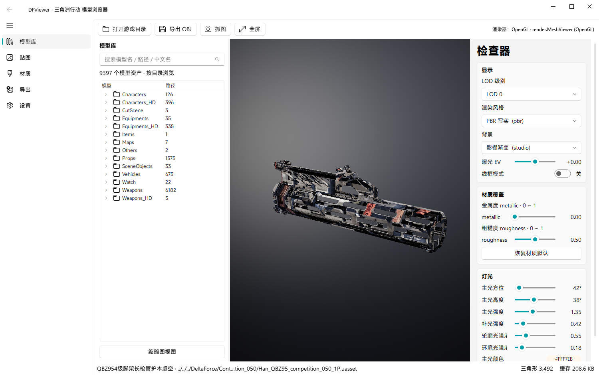

# VertexViewer · 模型浏览器

一个用 **PySide6 + Fluent 风格界面**写的 UE5 资产查看器：直接从游戏 `Content/Paks` 里按需解包、
在 OpenGL 里预览模型和贴图、调材质和灯光、导出 OBJ。**不落地完整解包**——只把当前查看的那个
资产的三件套（`.uasset/.uexp/.ubulk`）解密到本地缓存，关窗口即删。



真实抓图都放在 `docs/`：`01` 主界面、`02` 角色贴图、`03` 载具、`04` 卡通描边风格、
`05` 卡片式模型库、`06` 按游戏内中文名搜索、`07` 角色技能分类。

模型库默认就是**分好类的卡片界面**：顶部 13 个分类（全部/武器/配件/装备/弹药/钥匙卡/
藏品/容器/角色技能/角色/载具/道具/其他，其中钥匙卡、藏品、容器是把 Prop 再拆出来的），
一张卡片一件东西，写游戏内中文名和「N 个变体」；想看原始目录就按底部的**详细文件**切目录树。

## 1. 直接跑

双击 **`启动 VertexViewer.bat`**（或命令行 `python __main__.py`）。
首次启动会读 pak 索引，约 5 秒；之后模型库会列出 **9397 个可渲染网格**。

依赖（`requirements.txt`，缺了 bat 会自动装）：

```
PySide6>=6.9  numpy>=2.0
Pillow>=10.0  pycryptodome>=3.20  texture2ddecoder>=1.0.6  PyOpenGL>=3.1.7
```

## 2. 功能对照（你提的 7 条）

| # | 需求 | 实现在哪 | 怎么用 |
|---|---|---|---|
| 1 | 直接解包游戏文件 → 缓存 → 关闭即删 | `core/pak.py`、`cache.py` | 点左边模型即解包；缓存目录 `%LOCALAPPDATA%\VertexViewer\cache`，关窗前自动清空 |
| 2 | 调金属度、粗糙度 | `app/inspector.py`、`render/viewer.py` | 右栏「材质覆盖」两条滑杆，实时改所有 section |
| 3 | 调灯光 | `app/inspector.py`、`render/lighting.py` | 右栏「灯光」：主光方位/高度/强度、补光、轮廓光、环境光、光色 |
| 4 | 模型与贴图分离（GenTexDirHD 一一对应、材质 json） | `core/loader.py` | 自动按 `Models/X/Y/Z` → `GenTexDirHD/Game/Models/X/Y/Z/Textures` 配对；模型目录里的材质 json 也会读 |
| 5 | 导出 OBJ | `exporters/obj.py` | 工具栏「导出 OBJ」，含 `.mtl` 与贴图；可选 LOD、是否翻转 UV |
| 6 | 艺术化渲染 | `render/viewer.py`、`render/shaders/` | 右栏「渲染风格」：PBR 写实 / 卡通描边 / 色阶 / 霓虹 / 蓝图 / 素模 |
| 7 | 模型的中文名 | `core/cnnames.py`、`core/humanize.py` | 列表和标题栏显示「型号 + 部件」的显示名（如 `M4A1 机匣`、`SG553 枪管`）。名字由代号按本仓库自己的词典拼出来，**不读取游戏文本**；想换成游戏原名，把自备的 `work/names.json` 放进去即可覆盖 |
| 8 | 物品小图标 | `core/icons.py` | 读 `I:\Game\UIIcon`（可用 `VERTEXVIEWER_ICONS` 指定，需自行从游戏导出）；没有图标就画分类色块 + 首字，仓库不附带图标库 |
| 9 | 先导出模型再上材质 | `exporters/uemodel.py` | 导出页「先导出 .uemodel（几何）」只写几何+材质引用；`python -m exporters.uemodel x.uemodel --materialize out/` 再把材质贴图补上导 OBJ |
| 11 | 检视动画 | `core/inspection.py`、`core/inspection_catalog.py`、`core/inspection_scene.py`、`core/gunsmith_animation.py`、`app/inspection_page.py` | 默认跟随游戏 FPPCamera 挂点的第一人称视角；支持自由观察、角色手臂开关，以及改枪台当前完整装配的检视和 GLB 导出。配件保留原有位置，并绑定对应运动骨骼，导出包含模型、贴图、权重、动作和相机。 |
| 12 | 自定义图标 + 可分享图标表 | `core/usertable.py` | 卡片右键换图标，表存 `work/icon_table.json`；底部「图标表」可导出分享包 |
| 10 | 按游戏内名字搜模型 + 卡片式模型库 | `app/browser.py` | 左栏搜索框直接打中文名（「头盔」「阿萨拉突击背包」「M4A1」都行）；分类 chip 筛选；卡片视图带「合并变体」（1P/3P/UI/HD 只显示一张） |

图标覆盖率实测：45280 个网格里 **490 个有官方图标**（UIIcon 只画了装备/道具/头盔这一批，武器零件本身没有对应图标），
没图标的位置显示通用字形。

## 3. 它是怎么解开的（技术要点）

- **容器**：该游戏用的是 UE4 legacy `.pak`（version 11），没有 `.utoc/.ucas`。footer 204 字节在文件末尾，
  `index_offset/index_size` 指向的索引区整段是 `AES-256-ECB(明文 XOR mask)`。
- **密钥**：`AESKey1.json` 的 `Keys[]` 有 200 组 `(key, guid)`；每个 pak 用其中**一组**，且 **mask 单字节每个包不同**，
  所以要 201 个 key × 256 个 mask 枚举，用「`u64 PathHashSeed==0` + 合理 FileCount + 可打印 mount point」判定命中。
  （`MainKey` 只用于别的用途，单独解索引解不开。）
- **载荷**：条目数据同样 AES-256-ECB + 同一个 mask，加密块按 16 字节对齐读取；压缩条目交给游戏自带的
  `oo2core_8_win64.dll` 解 Oodle。
- **索引**：`EncodedPakEntries` 是 UE4 的 **bit-packed FPakEntry**（bit22=encrypted，bit23=compressed），不是定长结构。
- **uasset**：DF 的包是 UE4.27 以后的魔改（raw legacy `-4613 = -7×659`，UE4=522，**没有 FileVersionUE5 字段**）；
  名字表、import/export、属性标签都手写解析。导出体在 `uasset+uexp` 的虚拟坐标里（`virtual = uasset + uexp`）。
  骨骼网格取 **bind pose**（PositionVertexBuffer 已经是绑定姿势，不需要骨骼矩阵）。
- **贴图**：全是 BC7，最大 mip 在 `.uptnl`、中间 mip 在 `.ubulk`、小 mip 内联 `.uexp`，环境贴图还带 zlib 分块。
- **MRA 通道**：这游戏的打包贴图是 `R=金属度 G=粗糙度 B=AO`（不是 UE 的 ORM=`R=AO ... B=金属度`），
  按 ORM 读会把 AO 当成 0.05 把模型压黑；`scene.frag` 里已按 MRA 解释，滑杆一动就覆盖贴图值。

## 4. 能力边界（实测，不是猜）

- **87 个 pak 打不开**（`*optional*`、`*uhd*`、`semicommon_*`）：它们用的 key 不在这份 `AESKey1.json` 里，
  索引只有 192~8736 字节。**模型不受影响**——9397 个网格全在能解开的 257 个包里。
- **中文名覆盖 20%**（随机 400 个资产）：有本地化条目的配件/装备/载具/道具/角色能出真名；
  关卡场景件（`SM_*`）、AI 兵种、英雄本体、枪械本体在游戏里**根本没有**本地化字符串，UI 显示英文资产名。
- 检视支持可解码的非叠加骨骼动画；有配套第一人称 Body 动作时显示原始角色手臂，无配套资源时明确提示并播放物品动作。GLB 导出当前动作片段，使用原始帧率，播放倍速不影响导出。骨骼网格的**材质路径**游戏里没存在 uasset 属性表里，
  所以骨骼件靠「模型目录 Materials 里同名优先 + `GenTexDirHD` 目录配对」兜底；静态网格是直接读 `StaticMaterials`，100% 准确。
- 需要真显卡（OpenGL 3.3+）。没有 GL 时会自动退到软件着色占位视图，保证界面不崩。

## 5. 目录

```
core/     pak 解包、uasset 解析、网格/贴图/材质、中文名
render/   OpenGL 渲染器（PBR+6 种风格、灯光、后处理、阴影）
app/      Fluent 窗口、模型库、贴图页、材质页、导出页、设置页
exporters OBJ/MTL 导出
tools/    一次性工具：建索引、抓中文名、集成测试、探针
work/     生成的索引/名字表/预览图（可删，会自动重建）
```

## 6. 材质怎么绑（和 FModel 同一套语义）

贴图**只按目录找**，不跨目录猜名字 —— 跟 FModel 导出时的摆法一致：

1. `<模型目录>/Textures/`（角色/道具习惯把贴图放在自己目录下）
2. `GenTexDirHD/Game/Models/<同 tail>/Textures/`（武器/载具的分离贴图目录，和模型文件夹一一对应）
3. `Commerical/WeaponAppear/<赛季>/<皮肤>/.../Texture/`（皮肤目录，目录名 == 模型名）

槽位挑选是**打分**的，不是「命中第一个就用」：固有色只认
`BaseColorMap > BaseColor > AlbedoMap > Diffuse > ColorMap > _C > _D`，
`Mask/MRA/ORM/Emissive/Normal/UI/Icon/Logo/Decal` 这些一律挡在固有色之外，
`ORM/MRA` 只认 `MRAMap/MRA/ORMMap/ORM/ARM`。匹配按 **token 前缀**做，
不按裸子串（`BaseColorMap` 里含 `orm` —— col**orm**ap —— 用子串匹配会把固有色图判死）。

材质资产自带的 `texture_params` 优先，目录里挑到的图只填它空缺的槽；三处都没有就上中性灰
clay，绝不拿别的部位/别的皮肤的同名图顶上。设置页可以把「只按目录找」关掉，
退回老行为（全局按名字猜），默认是**开着**。

## 7. 导出

导出页有四个出口：

| 按钮 | 产出 |
| --- | --- |
| 选择目录并导出 / 导出到 exports/ | `.obj` + `.mtl` + `textures/*.png` |
| 先导出 .uemodel（几何） | 单文件几何（顶点/法线/UV/切线/索引 + 材质引用），不解析贴图 |
| 按 FModel 目录导出 | 照包路径还原：模型目录里 `.uemodel` + `.json`（材质）+ `.obj/.mtl`，贴图各自落回自己的 `Textures/` |

命令行也能用：

```bat
python -m exporters.fmodel_layout "DeltaForce/Content/Models/.../SM_X.uasset" out\
python -m exporters.fmodel_layout --list 20 out\          :: 抽样 20 个批量导
python -m exporters.uemodel out\SM_X.uemodel --materialize out\
```


## 打包（发布给别人）

```powershell
cmd /c "taskkill /F /IM VertexViewer.exe"     # 打包前必须先关掉，否则 _internal\Crypto\Cipher\_raw_aes.pyd 会占用
python -m PyInstaller VertexViewer.spec -y --noconfirm
```

产物 `dist/VertexViewer/`（约 200MB、500 多个文件）里带：

- `VertexViewer.exe`（8.2MB，无控制台）
- `_internal/`（Python 运行库 + OpenGL + BC 解码器 + 着色器 + `assets/logo.png`）
- `data/`（**可见、可替换**的数据目录，**不再放索引**）
  - `mesh_catalog.json` 8.7MB（路径→类名，检视动画扫描用；可选）
  - `AESKey1.json`、`pakinfo.json`（解包密钥与 pak 元数据；密钥自备）
  - `icon_table.json` / `icons/`（换图标后自动生成，可直接复制给别人）
  - `使用说明.txt`、`版本信息.txt`
  - 想用游戏原名：自己把 `names.json` 放进来（仓库与安装包都不附带）

> **物品图标库与中文名表不随包分发**：`icons.db`（游戏图标美术）与 `names.json`
> （本地化文本派生物）都在仓库与打包脚本里被剔除了。显示名改由 `core/humanize.py`
> 从资产代号生成（`Rec_AR_M4A1-Std_001_3P` → `M4A1 机匣`），图标改用分类色块 + 首字。

> **资产索引不再以文件形式随包分发**：它现在是一个 SQLite 数据库
> `%LOCALAPPDATA%\VertexViewer\index.db`（约 138MB、937088 条），第一次启动从游戏
> pak 生成（约 1 分钟、有真实进度），之后每次启动 2~3 秒直接读库。
> 这样索引位置固定、不会被 `data/` 挪动或清理工具扫掉，也不再出现
> 「找不到 fileindex.json」这种事。想手动重建：设置 → 数据维护 → 重建索引。
>
> 静态数据仍然找 `VERTEXVIEWER_WORK` > `exe目录/data` > `_internal/work` > `exe目录/work`
> 这几处（`core/loader.py::_work_dir()`）。换 `names.json` 就换名字，
> 换 `icon_table.json` 就换图标，不用重新打包。

发人用：

```powershell
cd dist
& "C:\Program Files\7-Zip\7z.exe" a -tzip -mx=6 "G:\VertexViewer-1.0-2026-10-26.zip" "VertexViewer"
```

产物约 **75MB**（zip 里顶层就是 `VertexViewer/`，解压出来直接能双击）。
首次启动如果没有游戏目录，会弹目录选择框；索引现场扫 pak 建库，
不需要联网、不需要装 Python。


## 启动加载界面

双击后先在屏幕正中显示一个 300×156 的**小方框**（直角、无圆角），上面是**真实进度**（不是假动画）：

    VertexViewer / 模型浏览器
    正在装载资产索引 · 600000/937088 个资产
    ████████████████████░░░░░░

索引读完后方框原地放大成主窗口（660ms，OutQuint），最后 130ms 交叉淡出，主窗口直接落在展开后的矩形上。
实现要点：

- `app/splash.py` 的 `SplashWindow`：无边框 + 半透明；窗口一开始就铺到目标矩形，
  动的是绘制出来的底板（`grow` 属性 0→1），全程只重绘不动窗口，所以不抖
- `core/loader.py` 的 `PROGRESS` / `progress()`：装载索引时每 20000 条写一次
  「已读压缩字节 / 总字节」和「已装载条目 / 总条目」
- 为什么能拿到真进度：索引从 `fileindex.json.gz` 换成了流式 `index.tsv.gz`
  （`tools/make_index_tsv.py` 生成，一行一个资产），边读边数；
  旧 JSON 是一次性 `json.load`，中间没有任何进度可报
- `app/__main__.py`：先在后台线程读索引 → 轮询 `progress()` 喂给卡片 →
  索引好了才构造主窗口（构造函数要建整棵控件树，会卡住 GUI）

想跳过加载界面（截图/自检）用 `VERTEXVIEWER_NOSPLASH=1`。
