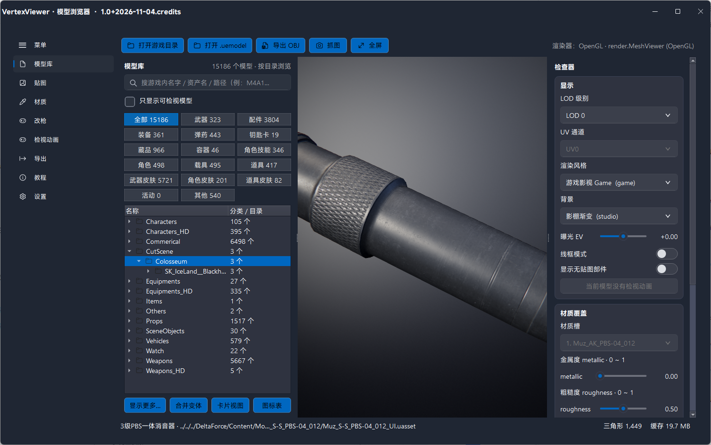

# VertexViewer · 模型浏览器


直接从游戏 `Paks` 里按需解包的 **UE 资产查看器**：PySide6 + FluentPy，
OpenGL 里预览模型与贴图、调材质和灯光、看检视动画、在改枪台上拼枪、导出 OBJ / `.uemodel`

不落地完整解包——只把当前查看资产的三件套（`.uasset/.uexp/.ubulk`）解密到本地缓存，关窗口就删除



更多实拍截图在 `docs/`：角色贴图、载具、卡通描边（实测是失）卡片式模型库、中文名搜索、分类筛选、
动画

## 目录

- [功能](#功能)
- [快速开始](#快速开始)
- [从源码编译](#从源码编译)
- [数据文件与解包密钥](#数据文件与解包密钥)
- [它是怎么解开的？？](#它是怎么解开的)
- [限制](#能力边界)
- [文档](#文档)
- [许可与第三方](#许可与第三方)

## 功能

| # | WhatWECANDO？（能干什么） | WhatCANISAY？（详细说明） |
|---|---|---|
| 1 | 按需解包 | 点一下只解那一个资产，缓存 `%LOCALAPPDATA%\VertexViewer\cache`，关窗前清空 |
| 2 | 模型库 | 17 个分类（全部/武器/配件/装备/弹药/钥匙卡/藏品/容器/角色技能/角色/载具/道具/武器皮肤/角色皮肤/道具皮肤/活动/其他），卡片视图、合并变体、只列真正有网格的资产 |
| 3 | 中文名搜索 |  情况多变，此处不多描述
| 4 | 贴图 / 材质 | 贴图只按目录配对（与 FModel 同一套语义），材质资产自带的 `texture_params` 优先；可整套切换材质 |
| 5 | 材质与灯光 | 金属度/粗糙度滑杆、主光/补光/轮廓光/环境光、6 种渲染风格（PBR 写实、卡通描边、色阶、霓虹、蓝图、素模） |
| 6 | 检视动画 | 跟随游戏 FPPCamera 挂点、角色手臂开关、改枪台整套装配的检视与 GLB 导出 |
| 7 | 改枪台 | 主件/官方配件/皮肤、逐槽位换件、自定义件与手动坐标、官方预设一键成套 |
| 8 | 导出 | OBJ + MTL + 贴图、`.uemodel`（几何）/`--materialize` 补材质、按 FModel 目录还原 |
| 9 | 图标 | 卡片图标可右键替换、导出分享包（`work/icon_table.json`） |
| 10 | 激活 | Ed25519 签名的机器码授权；激活记录存 `%LOCALAPPDATA%\VertexViewer` |（）

## 快速开始

**用打包好的单文件 exe**：见仓库 Releases（CI 在打 tag 时自动构建 `VertexViewer.exe`）。
首次启动选游戏目录（含 `Content\Paks` 的那一层），第一次会扫 pak 建索引（我的全量约 76 万条、1~2 分钟，之后每次启动 2~3 秒直接读库）

**直接跑源码**（Windows x64 + Python 3.12）：

```powershell
python -m venv .venv
.\.venv\Scripts\python.exe -m pip install -r requirements-build.txt
.\.venv\Scripts\python.exe __main__.py
```

或者双击 `启动 VertexViewer.bat`（缺依赖会自动an装）

## 从源码编译

```powershell
powershell -ExecutionPolicy Bypass -File .\build-source.ps1 -PythonExe .\.venv\Scripts\python.exe
```

`build-source.ps1` 会先跑回归测试再打 PyInstaller：默认产出 `dist/VertexViewer/`（目录版），
`-Format SingleFile` 出单文件，`-Format Both` 两种都出。

动画解码组件（C#）是自包含运行时，仓库里不带构建产物（`assets/animation/` 被忽略）。要重建：

```powershell
dotnet publish tools/animation_bridge/VertexViewer.AnimationBridge.csproj -c Release -r win-x64 `
  --self-contained true -p:SdkDirectory="$PWD\tools\animation_bridge\sdk" `
  -p:DebugType=None -p:DebugSymbols=false -o assets/animation
```

必须带 `--self-contained true` 和 `-r win-x64`：框架依赖版在没装对应 .NET 运行时的机器上起不来，
检视动画会静默失效。`tools/animation_bridge/sdk/` 里固定了编译用的依赖程序集。

## 数据文件与解包密钥

程序运行时读 `work/`（或 exe 旁的 `data/`）：

| 文件 | 用途 |
|---|---|
| `mesh_catalog.json` | 路径 → 类名，模型库与检视动画扫描用 |
| `names.json` | 中文名表 |
| `pakinfo.json` | pak 元数据 |
| `icons.db` | 物品图标 |
| `AESKey1.json` | **本仓库不附带**，AES密钥，自备放到 `work/AESKey1.json` |

没有 `AESKey.json` 时索引会报 `pak skip ...: no key/mask matched`、模型库为空。
索引本体是 SQLite（`%LOCALAPPDATA%\VertexViewer\index.db`），换游戏版本后按 pak 指纹自动重建。

## 它是怎么解开的

- **容器**：UE4 legacy `.pak`（version 11），没有 `.utoc/.ucas`。footer 204 字节在文件末尾，
  `index_offset/index_size` 指向的索引区整段是 `AES-256-ECB(明文 XOR mask)`
- **密钥**：AESKey1.json ;)
- **载荷**：条目数据同样 AES-256-ECB + 同一个 mask，块按 16 字节对齐读；压缩条目交给游戏自带的
  `oo2core_8_win64.dll` 解 Oodle
- **索引**：`EncodedPakEntries` 是 bit-packed FPakEntry（bit22=encrypted，bit23=compressed），不是定长结构。
- **uasset**：UE4 之后的魔改（raw legacy `-4613 = -7×659`，没有 FileVersionUE5 字段）；
  名字表、import/export、属性标签都手写解析。骨骼网格取 bind pose
- **贴图**：BC7，最大 mip 在 `.uptnl`、中间 mip 在 `.ubulk`、小 mip 内联 `.uexp`


## 能力边界

- 少数 `*optional*`、`*uhd*`、`semicommon_*` pak 的 key 不在常见密钥表里，打不开；模型不受影响
- 中文名覆盖不全：关卡场景件、AI 兵种、英雄本体、枪械本体在游戏里没有本地化字符串，UI 显示英文资产名
- 检视动画只支持可解码的非叠加骨骼动画；没有配套第一人称 Body 动作时播放物品动作并提示
- 骨骼网格的材质路径不在 uasset 属性表里，靠目录配对兜底；静态网格直接读 `StaticMaterials`
- 需要 OpenGL 3.3+；没有 GL 时会退到软件着色占位视图

## 文档

| 文件 | 内容 |
|---|---|
| `README-source.md` | 源码包内容、编译、不含密钥的约定 |
| `NOTES.md` | 本机实测备忘（pak/uasset 格式、索引、踩过的坑） |
| `docs/改枪逻辑.md` | 改枪装配全流程与阈值 |
| `docs/NOTES-*.md` | 各次修复的根因与验证数字（检视动画、皮肤、网格过滤、XM250 等） |

## 许可与第三方

本项目以 **AGPL-3.0** 发布，全文见 [LICENSE](LICENSE)。

第三方：CUE4Parse（Apache-2.0）及其原生组件、FluentPy（LGPL-3.0）、PySide6（LGPL-3.0）、
Oodle 解压使用游戏自带的 `oo2core` DLL（不随本仓库分发）。
